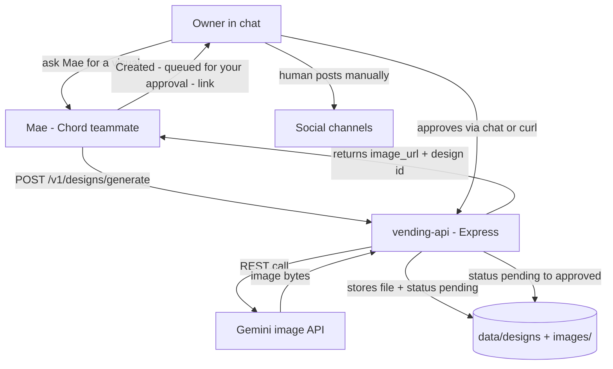

# Mae build plan — visuals with AI, human approves

Local build + local test first. Chord integration (and the image-delivery question) comes after.

## Decisions already made

- **Image API:** Gemini (Google AI Studio free API key; GCP credits as backup)
- **Human approves, human posts** — Mae creates into an approval queue, never publishes
- **One shared API** — Mae's endpoints live in `vending-api` (same repo, same server, same envelope/auth/idempotency conventions). The brief favors small over sprawling.
- **Image delivery in Chord:** unconfirmed — user asks TSG tomorrow. Design supports both: return an image **URL** (works either way) and, if Chord supports it, the image inline.

## Architecture



**Why the queue matters:** it is the real action for requirement 3 — state changes (`pending → approved/rejected`) driven by a tool call, and it encodes the owner's rule: the agent never posts.

## New endpoints (same conventions: envelope, Bearer auth, kobo-free)

| Method | Path | What it does |
|---|---|---|
| POST | `/v1/designs/generate` | Build a prompt from the brief, call Gemini, save image, status `pending`. Body: `kind` (model-shot / flyer / slide / social), `brief` (text), optional `garment` ref. Returns `id`, `image_url`, `prompt_used` |
| GET | `/v1/designs` | Approval queue — filter `?status=pending` |
| GET | `/v1/designs/:id` | One design + status + image_url |
| POST | `/v1/designs/:id/approve` | Human flips `pending → approved` |
| POST | `/v1/designs/:id/reject` | Human flips `pending → rejected` + `reason` |
| GET | `/images/:id.png` | Serves the generated file (no auth — it's a shareable link) |

**Error codes (matching our style):** `VALIDATION_FAILED`, `NOT_FOUND`, `INVALID_STATE` (approve twice), `IMAGE_API_UNAVAILABLE` (Gemini down / no key), `GENERATION_LIMIT` (cap hit).

## Gemini client — `src/gemini.js`

Mirror of `src/paystack.js`:

- `generateImage({ prompt, kind })` → POST to Gemini image model, returns image bytes
- Env: `GEMINI_API_KEY` (unset → clear `GEMINI_NOT_CONFIGURED` error)
- **Mock mode:** if `MAE_MOCK=1` or no key, generate a placeholder PNG locally (colored canvas with the prompt text) — so `npm test` and the local walkthrough never spend money or need a key
- Cap: max N generations per design request recorded in the skill rules (cost control)

## Data shape — `data/designs.json` (same store pattern)

```json
{
  "designs": [
    {
      "id": "des_abc123",
      "kind": "model-shot",
      "brief": "AI model wearing the yellow Sunday best dress",
      "prompt_used": "...",
      "image_file": "des_abc123.png",
      "status": "pending",
      "rejection_reason": null,
      "created_at": "..."
    }
  ],
  "generation_count": 3
}
```

## Skill mapping (files written after the API works)

| Skill | Uses |
|---|---|
| `graphics-and-flyers` | `generate` with `kind: flyer` → queue → report link |
| `ai-model-shots` | `generate` with `kind: model-shot` + garment description; rules: no real children, label illustrative |
| `presentation-slides` | `generate` with `kind: slide` (or text-outline only if images not wanted) |
| `design-requests` | routes cross-teammate briefs to the right `kind` |

All four share the same rule: **create → report the queue link → never claim it's posted.**

## Build steps

1. `src/gemini.js` — real client + mock mode
2. Designs store + routes in `src/app.js` (generate, queue, get, approve, reject, image serving)
3. Seed: `designs: []`, `generation_count: 0`
4. Tests: generate (mock) → pending → approve → approved; reject path; approve-twice → `INVALID_STATE`; no-brief → 422; limit cap; image file served
5. Local walkthrough: curl the full flow (generate → see queue → approve → open image_url in browser)
6. Update `openapi.json` + README + TESTING-FLOW
7. Commit + push

## Local test script (after build)

```bash
npm test                                    # full suite incl. designs
curl POST /v1/designs/generate -d '{"kind":"flyer","brief":"June sale - 20% off all dresses"}'
curl GET  /v1/designs?status=pending        # see the queue
curl POST /v1/designs/des_xxx/approve       # human approves
open http://localhost:3000/images/des_xxx.png
```

## Open questions (do not block the build)

- **Chord image delivery** — user confirms with TSG tomorrow; URL works regardless
- Gemini model name + free-tier quota — verify against Google AI Studio docs at build time
- Whether Mae shares Kemi's tool registration or gets her own (decide at Chord registration)