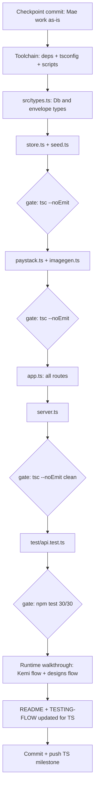

# TypeScript Migration Plan — vending-api

## Why (context)

Friend feedback: a JS-only take-home might be marked down. Re-read of the brief
(`tsg-labs-build-exercise.md`) shows **no language criterion in the rubric** — but the
decision is made: migrate fully to TypeScript, done safely, without losing the working
state (30/30 tests, proven Kemi flow, Mae designs flow).

**Non-goals:** no refactor of logic, no new features, no endpoint changes. This is a
mechanical, typed translation. `openapi.json` (the Chord tool contract) does not change.

## Current state

| File | Lines | Notes |
|---|---|---|
| `src/app.js` | 505 | Express app, all routes, biggest risk |
| `src/imagegen.js` | 254 | multi-provider image client |
| `src/paystack.js` | 103 | Paystack REST wrapper |
| `src/seed.js` | 55 | defines the canonical DB shape |
| `src/store.js` | 37 | JSON file persistence |
| `src/server.js` | 23 | bootstrap |
| `test/api.test.js` | ~350 | node:test, 30 tests, all green |
| `scripts/*.mjs` | 3 files | one-off Gemini debug scripts — **delete** (field notes already capture the findings) |

- ESM (`"type": "module"`), relative imports **already use `.js` extensions**
  (`./store.js`) → `moduleResolution: "NodeNext"` works with **zero import rewrites**.
- ⚠️ **Mae work is uncommitted** — first step must be a checkpoint commit.

## Key decisions

1. **Runner: `tsx`** — `npm start` / `npm test` run TS directly, no build step, no
   `dist/` in the repo. Type safety enforced separately by `tsc --noEmit` in
   `npm run typecheck`. (Alternative rejected: `node --experimental-strip-types` is
   experimental on Node 22.16 and prints warnings in a graded demo; a `tsc` → `dist/`
   build adds a step to the README for zero benefit here.)
2. **`tsconfig.json`: `strict: true`, `module/moduleResolution: "NodeNext"`**,
   `target: ES2022`, `noEmit: true`, `include: ["src", "test"]`.
3. **Types live in `src/types.ts`** — one `Db` interface (wallet, meters, phones,
   purchases, incoming, designs, generation_count) plus `Design`, `Purchase`,
   `FundingCredit`, envelope types. Derived from `seed.js` (the canonical shape).
4. **Express typing** — `Request`/`Response` from `express`, small helper types for the
   `{status, message, data}` envelope and error codes.
5. **Old `.js` files deleted only after their `.ts` twin is green** — git history is the
   safety net; a checkpoint commit exists before the first edit.

## Migration order (bottom-up, one gate per step)



### Gates (must pass before moving on)

- **G1** `npx tsc --noEmit` → 0 errors after each file group.
- **G2** `npm test` → 30/30 after the test file migrates.
- **G3** Runtime smoke: health → fund ₦10,000 → validate meter → purchase →
  replay; then designs generate (mock) → queue → approve → image served.
- **G4** Server starts clean via `npm start` (the exact command the README documents).

## package.json changes

```jsonc
"scripts": {
  "start": "tsx src/server.ts",
  "dev": "tsx watch src/server.ts",
  "test": "node --import tsx --test test/api.test.ts",
  "typecheck": "tsc --noEmit"
},
"devDependencies": {
  "typescript": "^5.x",
  "tsx": "^4.x",
  "@types/express": "^4.x",
  "@types/node": "^22.x"
}
```

## Risks and mitigations

| Risk | Mitigation |
|---|---|
| Breaking working code near deadline | Checkpoint commit first; delete old files only after green; git revert is one command |
| Strict mode floods errors in `app.js` (505 lines) | Migrate `app.js` last when all other types exist; type the envelope helpers first so routes inherit types |
| `node:test` + TS friction | `node --import tsx --test` is the documented pattern; test file is a near-mechanical rename |
| Windows/tsx quirks | Already the environment we develop in; verified at G4 |
| Time sink | Everything else in the todo list stays paused until G2 passes; if a gate stalls badly, the fallback is `git revert` to the checkpoint (JS state is fully working) |

## README additions (step N)

- Run section updated: `npm install` → `npm start`, plus `npm run typecheck` and
  `npm test`.
- Short **Design choices** note: TypeScript strict mode, contract-first
  (`openapi.json` is the source of truth shared with Chord), tsx for zero-build runs.
- AI-tool usage note (brief ground rule) updated to mention the TS migration.

## Out of scope (unchanged todos, resume after O)

Designs endpoints in `openapi.json`, Mae milestone commit (folded into A and O),
walkthrough for the recording, Chord questions, skills, submission assembly.
